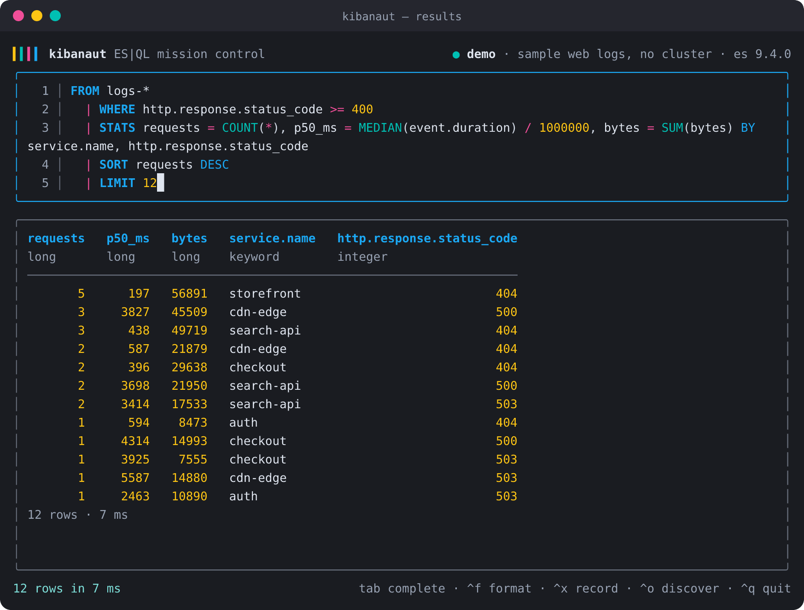
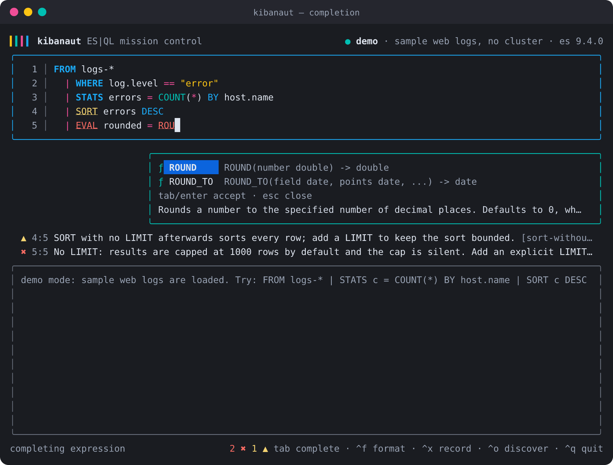
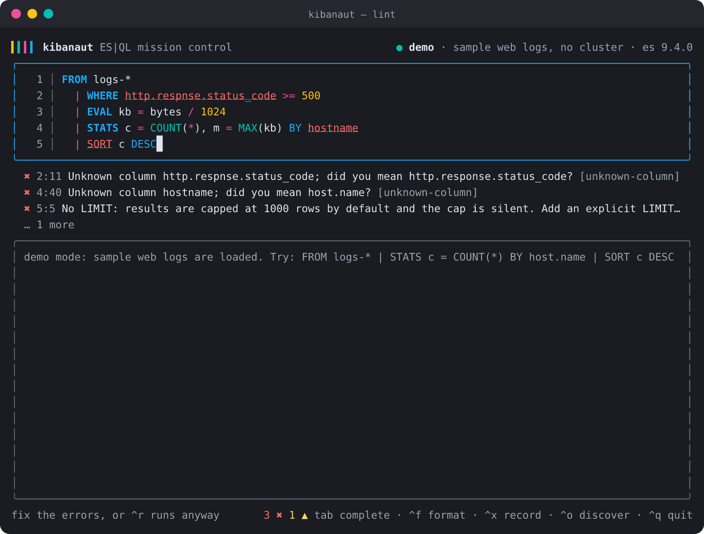
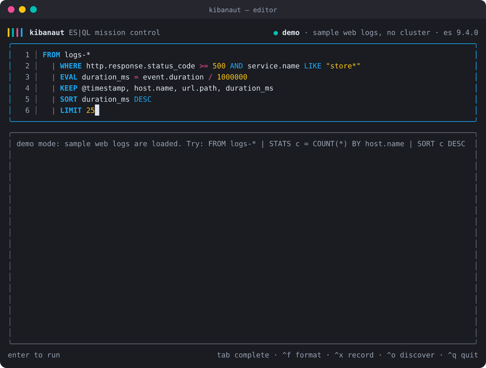
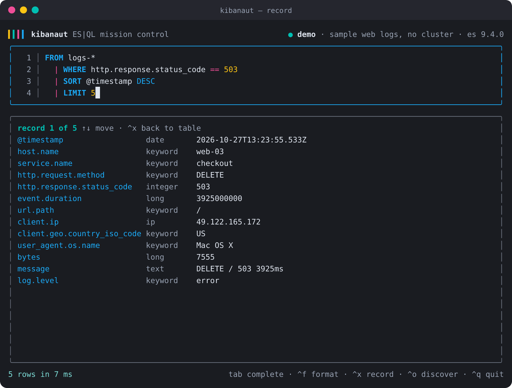

# kibanaut

Pilot Kibana from a mission-control terminal. `kibanaut` is an ES|QL TUI with linting and completion built into every command: it reads the same grammar Kibana's editor uses, checks your query against the live schema while you type, completes columns and functions in context, and runs the result through Kibana's console proxy or straight against Elasticsearch.



Everything in the screenshots is a real frame rendered by the TUI against the built-in demo data, so you can reproduce them with `kibanaut --demo`.

## What it does

- A full-screen editor with ES|QL syntax highlighting in the Elastic palette, one piped command per line, history, and `\` meta commands.
- Live lint as you type: syntax errors from the ES|QL grammar, unknown columns with did-you-mean hints, argument type and arity checks from the Elasticsearch function signatures, aggregation placement, plus performance warnings such as a missing `LIMIT`.
- Context-aware completion: commands after a pipe, indices after `FROM`, aggregations in `STATS`, group keys after `BY`, operators after an operand, enrich policies, lookup indices, and metadata fields.
- Results as a scrollable table or a per-row record view, exportable to CSV, with an open-in-Discover link one keystroke away.
- A scripting CLI with the same engine: `query`, `lint` (text, JSON, SARIF, GitHub annotations), `fmt`, `complete`, `schema`, `docs`.
- Shell completion for bash, zsh, and fish that also completes ES|QL inside `--query`.
- Credentials in the macOS Keychain (or Secret Service on Linux); nothing secret ever lands in the config file.

<table>
  <tr>
    <td></td>
    <td></td>
  </tr>
  <tr>
    <td></td>
    <td></td>
  </tr>
</table>

## Install

Requires Node 22 or newer.

```sh
# from a clone
git clone https://github.com/albertkhoury-elasticgov/Kibanaut.git
cd Kibanaut
npm install
npm run build
npm link            # puts `kibanaut` and the short alias `kq` on your PATH
```

Once published: `npm install -g kibanaut`.

## First run

```sh
kibanaut
```

With no profile configured, the TUI starts the setup wizard:

1. Kibana URL (and optionally a space).
2. Authentication: paste an API key, or enter a username and password. The password is exchanged immediately for a scoped API key through Kibana and is never stored.
3. A verification round-trip: `GET /api/status` on Kibana, cluster info, and a `ROW ok = 1` smoke query through the console proxy.
4. The key goes into the macOS Keychain (`security`), the Secret Service on Linux (`secret-tool`), or a 0600 file when neither exists. The profile itself (URL, space, username) lands in `~/.config/kibanaut/config.json`.

Scripted setups can skip the prompts:

```sh
printf '%s' "$KEY" | kibanaut init --profile prod --kibana-url https://kibana.example.com --space ops --api-key-stdin --non-interactive
```

For CI, environment variables replace the profile entirely: `KIBANAUT_KIBANA_URL`, `KIBANAUT_API_KEY`, and optionally `KIBANAUT_SPACE`; `KIBANAUT_ES_URL` switches to direct Elasticsearch access. `KIBANAUT_SECRET_STORE=file|keychain|secret-tool` forces a store.

No cluster handy? `kibanaut --demo` loads sample web logs with a small in-memory ES|QL evaluator (FROM, WHERE, EVAL, STATS, SORT, LIMIT, KEEP, DROP, RENAME, ROW).

## The TUI

| Key | Action |
| --- | --- |
| `enter` | run the query; while the pipeline is incomplete (trailing `\|`, open parenthesis) it inserts a newline instead |
| `alt+enter` | insert a newline |
| `tab` | open completion, or accept the highlighted suggestion |
| `\|` | starts the next command on its own line, matching the formatter |
| `↑` `↓` | move between lines; at the edges, walk the query history |
| `pgup` `pgdn` | scroll results |
| `^r` | run even when lint reports errors |
| `^f` | format the query |
| `^x` | toggle the record view for the selected row |
| `^o` | show an open-in-Discover link |
| `^s` / `^e` | save the query to a `.esql` file / export results to CSV |
| `^u` / `^w` / `^k` | clear the editor / delete the previous word / kill to end of line |
| `?` (empty editor) | help |
| `^q` | quit |

Meta commands are typed in the editor and submitted with enter: `\i [pattern]` lists indices, aliases, and data streams; `\d <index>` lists fields; `\p` lists enrich policies; `\x` toggles the record view; `\c` clears results; `\h` shows help; `\q` quits.

The status bar always shows the error and warning count for the current query. While a completion popup is open, diagnostics that overlap the word being typed are hidden so they do not flicker.

## CLI

```sh
kibanaut query "FROM logs-* | STATS c = COUNT(*) BY host.name | SORT c DESC | LIMIT 10"
kibanaut query -f report.esql --format csv --param since=2026-10-01 --async
kibanaut query "FROM logs-* | LIMIT 5" --discover        # prints a Discover deep link on stderr

kibanaut lint queries/*.esql --format github            # annotations in GitHub Actions
kibanaut lint report.esql --format sarif > lint.sarif    # for code scanning
kibanaut lint --fix --write queries/*.esql               # apply formatting fixes
kibanaut fmt --check queries/*.esql

kibanaut complete -q "FROM logs-* | WHERE " --format json
kibanaut schema indices "logs-*"
kibanaut schema fields "FROM logs-* | STATS c = COUNT(*) BY host.name"
kibanaut docs DATE_TRUNC
kibanaut config list | use prod | remove staging | set functionCase lower | rules
```

`query` lints before sending. Errors stop the query (exit code 2) unless `--no-lint` is given; warnings print to stderr. Output defaults to a table on a terminal and JSON when piped.

### Shell completion

```sh
# zsh
kibanaut completion zsh > ~/.zfunc/_kibanaut   # make sure ~/.zfunc is in $fpath, then run compinit
# bash
kibanaut completion bash >> ~/.bashrc
# fish
kibanaut completion fish > ~/.config/fish/completions/kibanaut.fish
```

The scripts complete subcommands, flags, profile names, and the query text after `-q` / `--query` by calling `kibanaut complete` on the partial query (zsh and fish support in-word completion; bash completes whole words).

## Lint rules

| Code | Rule | Default | What it checks |
| --- | --- | --- | --- |
| E001 | syntax | error | Parse errors reported by the ES|QL grammar |
| E002 | unknown-function | error | Function name is not in the grammar |
| E003 | arity | error | Argument count outside every signature |
| E004 | argument-type | error | Argument type (literal, column, or inferred) matches no signature |
| E005 | unknown-column | error | Column does not exist at that point in the pipeline; suggests the closest name |
| E006 | aggregation-outside-stats | error | `COUNT`, `AVG`, ... used outside `STATS` |
| E007 | nested-aggregation | error | An aggregation inside another aggregation |
| W101 | no-implicit-limit | warning | No `LIMIT`; results are silently capped at 1000 rows |
| W102 | sort-without-limit | warning | `SORT` with no `LIMIT` after it |
| W103 | unused-eval-column | warning | An `EVAL` column that is never referenced and never reaches the output |
| W104 | filter-on-group-after-stats | warning | A `WHERE` on group keys that could run before `STATS` |
| W105 | preview-function | warning | Function is in technical preview or snapshot-only |
| W106 | wildcard-source | warning | `FROM *` |
| W107 | limit-above-cap | warning | `LIMIT` above the 10000 row cap |
| S201 | keyword-case | info, fixable | Commands and keywords in upper case (function case is configurable) |
| S202 | one-command-per-line | info, fixable | Each piped command on its own line |

Column tracking follows `EVAL`, `STATS`, `KEEP`, `DROP`, `RENAME`, `DISSECT`, and `GROK` patterns, and `ENRICH ... WITH`. After commands whose output cannot be known statically (`ENRICH` without `WITH`, `LOOKUP JOIN`, `FORK`), unknown-column checks switch off for the rest of the pipeline rather than guessing.

Configure severities in a `.kibanautrc.json` found by walking up from the current directory:

```json
{
  "rules": { "no-implicit-limit": "error", "one-command-per-line": "off" },
  "functionCase": "upper"
}
```

Inline: `// kibanaut-disable-next-line no-implicit-limit` or `// kibanaut-disable-line`.

## Elastic colors

The TUI is themed on the Elastic brand palette, with every color defined once in [`src/ui/theme.ts`](src/ui/theme.ts): yellow `#FEC514`, teal `#00BFB3`, pink `#F04E98`, and blue `#1BA9F5` from the logo, the EUI shades for chrome, and the EUI dark-mode text variants for errors and warnings so they stay readable on dark terminals. Commands and keywords are blue, functions teal, literals yellow, pipes and operators pink. Terminals without truecolor get named fallbacks instead of the nearest-16-color guess.

## How it works

- Parsing, the typed AST, and formatting come from [`@elastic/esql`](https://www.npmjs.com/package/@elastic/esql), the package the Kibana ES|QL team maintains.
- Function and operator signatures are synced from the Elasticsearch repository at a release tag into `src/definitions/functions.json` (`npm run sync-definitions -- --tag v9.4.0`). `kibanaut --version` prints the bundled tag, and `init` warns when the cluster's minor version differs so you know when to resync.
- The semantic linter and the completer are kibanaut's own, built on the AST, the signatures, and a column-flow tracker. Schema comes from the cluster: `<pipeline so far> | LIMIT 0` for exact columns, `_resolve/index` for sources, `_enrich/policy`, and lookup-mode index settings, all cached per profile with a TTL.
- Queries run through Kibana's console proxy by default (`/api/console/proxy`, space-aware) so only the Kibana URL is needed. `--via es` with an Elasticsearch URL talks to `_query` directly, including the async API for long queries.

## Development

```sh
npm install
npm run typecheck
npm test                 # vitest, including headless TUI frame tests
npm run build
npm run screenshots      # regenerates docs/screenshots/*.svg and *.png from real frames
npm run sync-definitions -- --tag v9.4.0
```

Headless rendering (`kibanaut snapshot --scene results --ansi`) captures the exact ANSI frame the TUI draws; `src/render/ansi-svg.ts` turns it into the SVG terminal window used for the screenshots.

## Roadmap

- `kibanaut lsp --stdio` so editors get the same diagnostics and completion for `.esql` files.
- A parity harness against Kibana's own validation and autocomplete fixtures.
- Kibana saved queries and data views as first-class sources in the TUI.
- Single-binary releases via Node SEA or `bun build --compile`.

## License

MIT. ES|QL language packages are licensed by Elastic under the Elastic License 2.0.
